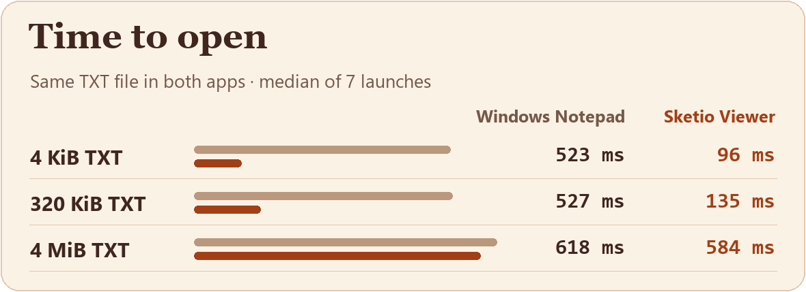
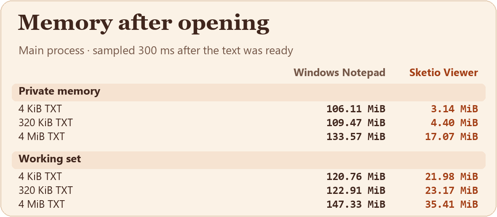

<p align="center">
  
</p>

<p align="center">
  <a href="https://github.com/NerimoZ/sketio-viewer/releases/download/v0.1.0/Sketio-Viewer-Setup-0.1.0-x64.exe"></a>
  <a href="https://github.com/NerimoZ/sketio-viewer/releases/download/v0.1.0/SketioViewer.exe"></a>
</p>






<details>
<summary>Benchmark data and method</summary>

The test compared the Sketio Viewer v0.1.0 release executable with Windows Notepad 11.2609.11.0 (Microsoft Store package) on Windows 11 build 26200 and an Intel Core i3-10100F.

Each app opened the same local UTF-8 TXT file in a new process with one test tab. Startup time runs from process launch until the visible editor returns the expected text and document length. Memory is for the main process, sampled 300 ms after the editor was ready. Results are medians of seven measured launches per app and file size, with alternating order and one warm-up per app.

| TXT file | Notepad open | Viewer open | Notepad private | Viewer private | Notepad working set | Viewer working set |
| --- | ---: | ---: | ---: | ---: | ---: | ---: |
| 4 KiB | 523 ms | 96 ms | 106.11 MiB | 3.14 MiB | 120.76 MiB | 21.98 MiB |
| 320 KiB | 527 ms | 135 ms | 109.47 MiB | 4.40 MiB | 122.91 MiB | 23.17 MiB |
| 4 MiB | 618 ms | 584 ms | 133.57 MiB | 17.07 MiB | 147.33 MiB | 35.41 MiB |

| Size on disk | Windows Notepad | Sketio Viewer |
| --- | ---: | ---: |
| Executable | 3,212,128 B (3.06 MiB) | 978,944 B (0.93 MiB) |
| App files | 18,462,934 B (17.61 MiB) | 1,100,023 B (1.05 MiB) |

Notepad's app size is the sum of the files in its main installed x64 package, including its bundled assets. Viewer app files include the EXE and the file-association icon. Shared Windows libraries, separate packages, and per-user data are excluded.

</details>

<details>
<summary>Installation, shortcuts, and build instructions</summary>

## Install

Run the Windows x64 installer for the current user or open the standalone EXE. Choose **Sketio Viewer** in **Settings → Apps → Default apps** to make it the default for `.md`, `.markdown`, and `.txt`.

## Use

Launch the viewer or pass a Markdown or TXT file on the command line.

```powershell
& .\target\release\SketioViewer.exe .\README.md
```

| Shortcut | Action |
| --- | --- |
| Ctrl+N | New text tab |
| Ctrl+Shift+N | New window |
| Ctrl+O | Open Markdown or TXT |
| Ctrl+S | Save changes |
| Ctrl+Shift+S | Save as |
| Ctrl+Alt+S | Save all modified tabs |
| Ctrl+P | Print |
| Ctrl+R | Reload the current file |
| Ctrl+G | Go to line |
| F5 | Insert local time and date |
| Ctrl+F | Find in the current document |
| Ctrl+H | Find and replace |
| F3 / Shift+F3 | Next / previous match |
| Alt+Left | Return to the previous document |
| Ctrl+Shift+L | Switch light and dark |

The viewer restores your tabs at launch and reads background documents when you first select them.

Drop a Markdown or TXT file into the window to open it. TXT files always display as plain text. In Markdown files, the line with the caret shows the original markup while headings, wrapping tables, nested lists, task checkboxes, quotes, and inline styles stay formatted on surrounding lines. Use the **Markdown on/off** button in the status bar or **View → Markdown formatting** to switch between live formatting and plain source.

Use **View → Reading view** for embedded images and clickable links. Relative assets and documents work offline. Web links open in your default browser.

## Build

Build the native viewer on Windows x64 with the Rust MSVC toolchain.

```powershell
cargo test --locked --bin SketioViewer
cargo build --release --locked --bin SketioViewer
```

Build the Windows installer with Inno Setup 6 installed.

```powershell
pwsh -File .\installer\build.ps1
```

</details>
