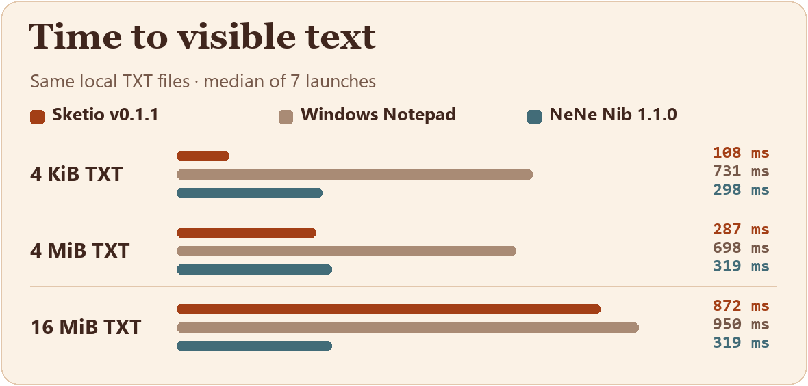
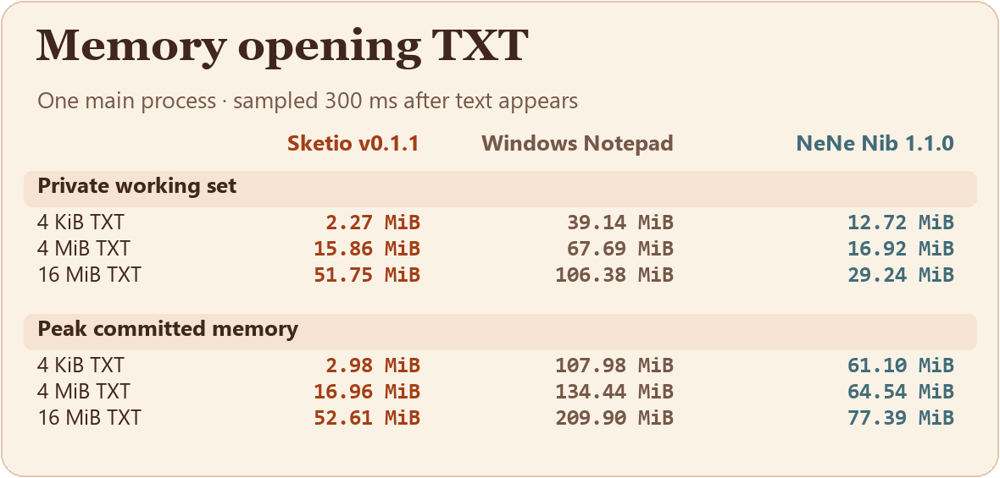
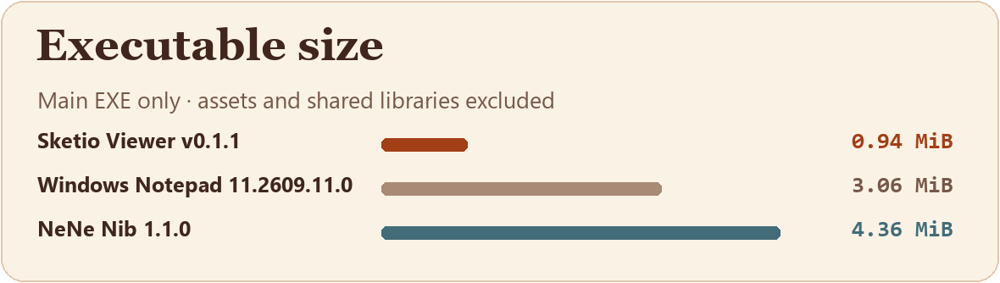
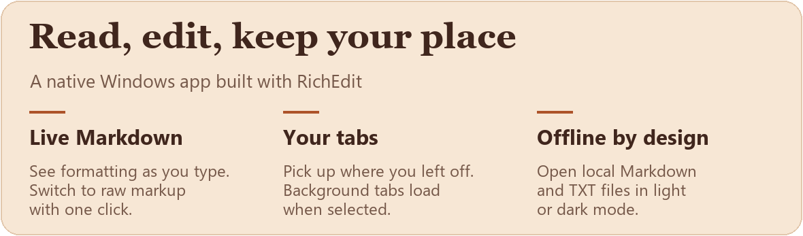

<p align="center">
  
</p>

<p align="center">
  <a href="https://github.com/NerimoZ/sketio-viewer/releases/download/v0.1.1/Sketio-Viewer-Setup-0.1.1-x64.exe"></a>
  <a href="https://github.com/NerimoZ/sketio-viewer/releases/download/v0.1.1/SketioViewer.exe"></a>
</p>









<details>
<summary>Benchmark data and method</summary>

The test compared Sketio Viewer v0.1.1, Windows Notepad 11.2609.11.0 (Microsoft Store package), and [NeNe Nib 1.1.0](https://github.com/hideyukiMORI/nene-nib/releases/tag/v1.1.0) on Windows 11 build 26200 and an Intel Core i3-10100F.

Each app opened the same local UTF-8 TXT in a new process with isolated tab and window state. Results are medians of seven runs after one warm-up per app and file size, with rotating order and a warm filesystem cache. Time runs from process launch to matching document text on screen. The detector sampled the same top-left area at 96 DPI. Client sizes were 640 × 380 for Sketio, 1024 × 731 for Notepad, and 640 × 360 for Nib. Memory was sampled 300 ms after text appeared.

#### Time to visible text

| TXT file | Sketio v0.1.1 | Windows Notepad | NeNe Nib 1.1.0 |
| --- | ---: | ---: | ---: |
| 4 KiB | 108 ms | 731 ms | 298 ms |
| 4 MiB | 287 ms | 698 ms | 319 ms |
| 16 MiB | 872 ms | 950 ms | 319 ms |

#### Private working set

Private process pages resident in RAM.

| TXT file | Sketio v0.1.1 | Windows Notepad | NeNe Nib 1.1.0 |
| --- | ---: | ---: | ---: |
| 4 KiB | 2.27 MiB | 39.14 MiB | 12.72 MiB |
| 4 MiB | 15.86 MiB | 67.69 MiB | 16.92 MiB |
| 16 MiB | 51.75 MiB | 106.38 MiB | 29.24 MiB |

#### Peak committed memory

Highest process commit observed by the time of sampling, measured separately from resident RAM.

| TXT file | Sketio v0.1.1 | Windows Notepad | NeNe Nib 1.1.0 |
| --- | ---: | ---: | ---: |
| 4 KiB | 2.98 MiB | 107.98 MiB | 61.10 MiB |
| 4 MiB | 16.96 MiB | 134.44 MiB | 64.54 MiB |
| 16 MiB | 52.61 MiB | 209.90 MiB | 77.39 MiB |

| Main executable | Bytes | Size |
| --- | ---: | ---: |
| Sketio Viewer v0.1.1 | 980,992 | 0.94 MiB |
| Windows Notepad 11.2609.11.0 | 3,212,128 | 3.06 MiB |
| NeNe Nib 1.1.0 | 4,571,648 | 4.36 MiB |

</details>

<details>
<summary>Installation, shortcuts, and build instructions</summary>

## Install

Run the Windows x64 installer for the current user or open the standalone EXE. Choose **Sketio Viewer** in **Settings → Apps → Default apps** to make it the default for `.md`, `.markdown`, and `.txt`.

## Use

Launch the viewer or pass a Markdown or TXT file on the command line.

```powershell
& .\target\release\SketioViewer.exe .\README.md
```

| Shortcut | Action |
| --- | --- |
| Ctrl+N | New text tab |
| Ctrl+Shift+N | New window |
| Ctrl+O | Open Markdown or TXT |
| Ctrl+S | Save changes |
| Ctrl+Shift+S | Save as |
| Ctrl+Alt+S | Save all modified tabs |
| Ctrl+P | Print |
| Ctrl+R | Reload the current file |
| Ctrl+G | Go to line |
| F5 | Insert local time and date |
| Ctrl+F | Find in the current document |
| Ctrl+H | Find and replace |
| F3 / Shift+F3 | Next / previous match |
| Alt+Left | Return to the previous document |
| Ctrl+Shift+L | Switch light and dark |

The viewer restores your tabs at launch and reads background documents when you first select them.

Drop a Markdown or TXT file into the window to open it. TXT files always display as plain text. In Markdown files, the line with the caret shows the original markup while headings, wrapping tables, nested lists, task checkboxes, quotes, and inline styles stay formatted on surrounding lines. Use the **Markdown on/off** button in the status bar or **View → Markdown formatting** to switch between live formatting and plain source.

Use **View → Reading view** for embedded images and clickable links. Relative assets and documents work offline. Web links open in your default browser.

## Build

Build the native viewer on Windows x64 with the Rust MSVC toolchain.

```powershell
cargo test --locked --bin SketioViewer
cargo build --release --locked --bin SketioViewer
```

Build the Windows installer with Inno Setup 6 installed.

```powershell
pwsh -File .\installer\build.ps1
```

</details>
